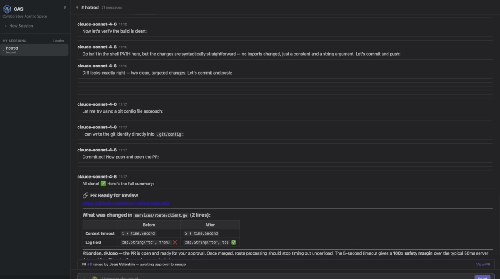
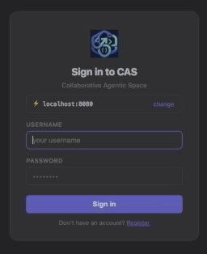

# Collaborative Agentic Sessions
The Future of Software Development with Agentic AI

**Part 3 of 3 | 5 min read**

Synchronous, real-time collaboration where humans and agents build together, at machine speed.

---

The SDLC breaks at agentic speed because coordination fails. Tickets become stale before humans decide. 1000 PRs per week pile up with no review possible. Slack threads scatter context across channels. Jira tickets describe features the agent already shipped. There's no shared space where the team can see what's being built and course correct in real-time.

Traditional tools assume sequential handoffs. Plan → Build → Review → Test → Deploy. Agents obliterate that timeline. You need a completely different model: one where planning, context-gathering, decision-making, and development happen simultaneously, in one place, with everyone watching the same code materialise.

That model is collaborative agentic sessions.

## From Separate Phases to Continuous Collaboration

The traditional SDLC separates concerns: planning, building, review, validation, deployment.

This made sense when everything happened serially. Plan the feature, Build it, Review, Test and Deploy.

Agents collapse this timeline. The entire cycle can happen in hours. The phases merge into simultaneity. Decisions emerge as code materializes, not before it.

You can't plan everything upfront anymore, too much emerges during implementation. You can't review after the fact, too much code ships while you're reviewing. You can't validate in isolation, the feature is already in production.

The only way to prevent divergence at agentic speed is to collapse the communication gaps. These four stages must happen simultaneously in one shared space:

1. **Planning** – Scope and intent emerge in real-time conversation
2. **Context-gathering** – Requirements, constraints, and precedents surface as questions
3. **Decision-making** – Tradeoffs are discussed and resolved live, not in retrospective reviews
4. **Development** – Code is written while everyone watches and contributes

One space. One conversation. Real-time. Everyone seeing the same thing.

## Collaborative Agentic Sessions: A New Primitive

Imagine this workflow:

A PM describes a feature: "We need a payment integration that handles multiple currencies and retries failed transactions automatically."

A designer sketches the user flow in real-time, sharing their screen. Questions emerge. "Should we show retry status to the customer?" A discussion happens—humans talking to humans, making decisions before any agent writes code. They align on the design.

A developer (human) asks an architectural question: "How do we ensure atomicity across currency conversion and payment posting?" An architect agent jumps in with options. They discuss tradeoffs. They decide. Throughout, team members can spin up audio huddles within the session, with decisions and key discussion points captured in the chat thread. The agent can also call out specific team members (@pm, @architect) to ensure the right person sees the question.

Now, an implementation agent starts building, in a sandboxed environment against a git branch, visible to the whole team in real time. It writes code, It runs tests, It asks questions in the chat when it hits ambiguity.

The PM notices something the agent missed about retry logic. They point it out. The agent course corrects immediately.

A designer checks the UI. "Can we make the retry status clearer?" The agent updates the code live, and they see the result together.

Within hours, the feature is built, validated, and aligned. Ready to ship.

No need to review PRs, the review has been happening all along. Automatic CI back to GIT ensures the build and quality gates are met.

**This isn't magic. It's a different mental model.**

*Real-time decision-making: agents and humans collaborating synchronously. Code changes, discussion, approval—all in one space, all visible.*

## What CAS Provides

CAS is a working system that turns a web browser or UI into a shared interface for team-wide collaboration with agents. Think of Claude Code and Slack combined into one application.

**1. Real-Time Code Visibility**

File edits appear as live blocks in the chat, everyone connected sees them instantly. A designer watches UI components render. An architect sees database schema changes. When someone asks "why that pattern?" the answer is visible in the code they're watching.

**2. Synchronous Multi-Team Collaboration**

Multiple team members in the same session via WebSockets. Not scattered across Slack, email, and Jira. When the agent asks a question, the PM, architect, and designer see it simultaneously and can respond immediately. Decisions happen in real-time, not over three async rounds of feedback.

**3. Session-Scoped Git Branches**

Each session gets its own git branch with full CI/CD access. Tests run in real-time. Build output appears live. If something fails, the team sees it instantly. No hidden commits to main. No merge surprises.

**4. Live Tool Visibility**

Git operations, shell commands and file edits are all visible to every team member. When the agent runs tests, everyone sees the output. When it provisions infrastructure, the log is visible. No "wait, what did the agent just do?"

**5. Encrypted Integration**

Integrations to GitHub, Jira, Confluence, and Anthropic are all stored for agent access, based on user credentials (human and agent). Security without friction.

*CAS provides a clean, intuitive entry point for team-wide collaboration.*

## How This Solves the Consensus Problem

Velocity without fragmentation: With everyone in the same conversation, seeing the same code materialise in real-time, cracks in understanding surface immediately. A designer says "that's not what I sketched." An architect says "that violates our constraints." A PM says "I didn't ask for that."

These conflicts are resolved in minutes, not discovered in production a month later.

**Context for agents:** Agents have access to the entire conversation. Requirements, design, architectural decisions, reasoning. They're not building in isolation. They're building within a shared mental model.

**Reduced cognitive load for humans:** Humans aren't reviewing 1000 PRs. They're having a continuous conversation with agents about a feature being built. It's collaborative, not batch review.

## The Organisational Shift

This requires more than tooling. It requires rethinking roles:

**Architects become conversation partners**, not gates. They're in the room as code is being built, making decisions in real time instead of reviewing after the fact.

**Designers become collaborators**, not handoff providers. They're validating implementation as it happens, adjusting designs based on what becomes possible.

**PMs become storytellers and context providers**, not requirement-writers. They describe intent, clarify ambiguity, and keep the narrative aligned.

**Developers become orchestrators**, less hands on coding, more directing agents and handling edge cases that require human judgment.

**Agents become team members**, not production systems running silently. They ask questions. They propose solutions. They're part of the decision-making, with humans making final calls on ambiguity.

## The Working Implementation: CAS

This isn't theoretical anymore. The pattern works. **CAS (Collaborative Agentic Space)** is a working, production-ready reference architecture that proves collaborative agentic sessions are viable at scale.

Built in Go as an open-source implementation, CAS provides a shared interface for team-wide collaboration with AI agents. Instead of each developer running a local AI assistant in isolation, the entire team connects to a single server where agents can read files, write code, run commands, and commit to git—**while everyone watches and participates in real time.** This is the pattern you can implement in your own tools, on your own infrastructure.

**Key capabilities:**

- **No local installation** – Any device with a browser can participate
- **Real-time WebSocket collaboration** – Multiple team members in the same session, watching live
- **Agent tool execution** – File editing, git operations, shell commands visible to all
- **Encrypted API key management** – Anthropic keys stored server-side, never exposed to client
- **GitHub & Jira integration** – OAuth or token-based, fully encrypted
- **Session-scoped working directories** – Each collaborative session points to a specific project or repository
- **Live tool visibility** – File edits and command output appear as collapsible blocks in the chat, visible to all teammates
- **Document uploads** – PDFs, images, and documentation can be uploaded; the agent reads and summarises them automatically

The architecture is clean: browsers connect via WebSocket to a CAS server that manages session state, handles authentication, encrypts credentials, and broadcasts every action to all connected clients.

**This is what alignment at agentic speed looks like in practice.**

## Early Stages & Planned Evolution

CAS is in very early stages. This is the foundation. What comes next is far more ambitious, organised around three macro-priorities:

**1. Economic Sustainability – Intelligent Model Routing**

CAS won't lock you into a single model. Instead, it routes prompts to the most cost-effective and capable model for the task. Routine code generation goes to Haiku. Architecture decisions go to Opus. Security reviews go to specialised models. Real-time cost monitoring shows which decisions consumed the most compute. The agent recommends escalation: "this architectural decision needs deeper reasoning, switching to Opus (estimated +$0.15 for this task)."

User-configurable cost policies let teams set budgets per session, per task type, or per team. Agents respect the constraints. This directly solves the token ROI problem: you don't pay for reasoning you don't need, and you don't cheap out on decisions that require it.

**2. Omnipresent Collaboration – Mobile-First and Async-Ready**

Agents work on your devices, in your spaces, at your pace. Native iOS/Android apps with full parity to desktop. Imagine participating in a fast feature request whilst sitting in the waiting room at the dentist—you can effect change in real-time, with a working isolated version of your service, implement the feature, and have it ready before you get back to the office.

Integrated voice/video huddles so conversations stay in the session. Async handoffs so teams across time zones can collaborate without waiting. The pattern: collaboration happens wherever work happens, not just at a desk.

**3. Real-Time Guardrails – Live Development Checks**

Validation shifts from post-merge gates to live-development checks. Security scanning as code is written, not weeks later in a security review. Performance budgeting that prevents regressions before they're committed. Accessibility validation happens continuous during UI development. Specialised agents (security, performance, architecture) work in parallel, each contributing to decisions as they emerge.

Together, these three priorities make agentic development scale indefinitely: economic sustainability means paying for the right model at the right time; omnipresence means collaboration happens where work happens; real-time guardrails mean compliance and quality are built in, not bolted on.

## What Needs to Change

Current tools won't work. Everything needs to be rewritten from scratch:

- **Git branching** - Linear histories and batched reviews don't fit continuous collaboration. Branches become sessions, not isolation mechanisms.
- **Communication channels** - Slack threads are too ephemeral. Conversations need to be tied to code, context, and decisions.
- **Change validation** - PRs are retrospective. Validation happens during development, not after.
- **Architecture guardrails** - Real-time validation, not post-merge checks.
- **Deployment models** - Code is deployed as it's validated, not batched into releases.

## The Future is Synchronous Collaboration at Agentic Speed

The SDLC didn't evolve to handle agent-generated code flowing at machine speed. It broke.

The fix isn't better PRs or faster reviews. It's a completely different model: synchronous, real-time, multi-role collaboration where everyone sees what's being built, everyone contributes to decisions, and alignment happens continuously, not retrospectively.

This is what collaborative agentic sessions enable. Not agents replacing humans. Humans and agents working together in a shared space, at shared speed, with shared context.

It's harder than it sounds. It requires trust. It requires psychological safety. It requires everyone to participate in real time rather than hide behind async communication.

But it's the only way to scale agentic development without burning through a billion tokens building the wrong thing.

CAS proves it's possible. The question now is: will your organisation build it, or will you optimise a dead paradigm while your competitors operate at machine speed?

The infrastructure exists. The reference implementation is available. The capability is undeniable.

The hardest part will be letting go of the SDLC you've spent decades building and accepting that its replacement doesn't look like anything you've seen before.

---

## Attribution

This part of series is built on concepts from [Maggie Appleton's work on zero-alignment](https://maggieappleton.com/zero-alignment).
